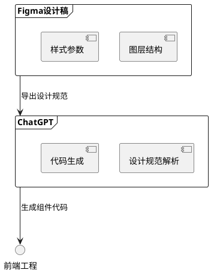

---

## 目录

- [核心技巧](#核心技巧)
- [代码优化与重构](#代码优化与重构)
- [多语言处理](#多语言处理)
- [开发辅助](#开发辅助)
- [跨平台适配](#跨平台适配)
- [扩展应用](#扩展应用)


---

## 核心技巧

### Prompt生成方法论

1. **多Prompt生成**

   - 通过生成多个prompt迭代优化输出质量
   - 示例流程：
     ```python
     # 生成初始Prompt → 评估结果 → 生成改进Prompt → 最终优化
     ```
2. **角色扮演**

   - 作为超级语言解释器（处理复杂语义）
   - 作为提示词训练器（生成领域专用Prompt）
3. **格式规范**

   - 强制JSON/YAML结构化输出
   - 表格化数据呈现

---

## 代码优化与重构

### 10大即时代码重构技巧

| 优化方向 | 典型操作       | 适用场景   |
| -------- | -------------- | ---------- |
| 性能优化 | 算法复杂度分析 | 循环结构   |
| 兼容性   | 多语言语法适配 | 跨平台项目 |
| 可维护性 | 模块化拆分     | 大型工程   |

**重构步骤示例：**

1. 使用最新库版本替换过时代码
2. 将ArrayList改为ConcurrentHashMap（数据结构优化）
3. 添加try-with-resources错误处理

---

## 多语言处理

### 多语种翻译工作流


**关键注意事项：**

- 使用 `LANG_CODE`作为字典key
- 保留原始文本占位符（如 `{0}`）
- 优先处理数字/日期格式

---

## 开发辅助

### 测试驱动开发（TDD）

1. **UT生成**

   - 输入：方法签名 + 边界条件
   - 输出：JUnit/TestNG测试套件
   - 覆盖率分析建议
2. **Mock数据生成**

   ```json
   {
     "user": {
       "id": "##number(1,100)",
       "name": "##name.fullName"
     }
   }
   ```

---

## 跨平台适配

### iOS布局转换

**Objective-C框架迁移流程：**

```objective-c
// 原始Frame布局
CGRectMake(10, 20, 30, 40);

// Masonry转换后
make.top.equalTo(20);
make.left.equalTo(10);
make.width.equalTo(30);
make.height.equalTo(40);
```

**优化建议：**

- 将布局逻辑拆分为 `setupConstraints`方法
- 使用 `MAS_SHORTHAND`简化语法

---

## 扩展应用

### Figma+ChatGPT协作



---

## 附录

### 实用资源

- [Prompt精选库](https://www.aishort.top/?tags=code)
- Recharts数据可视化库
- Lucide React图标集
